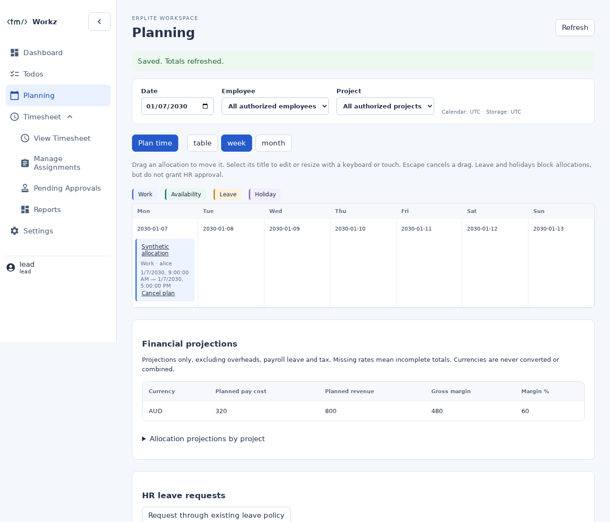
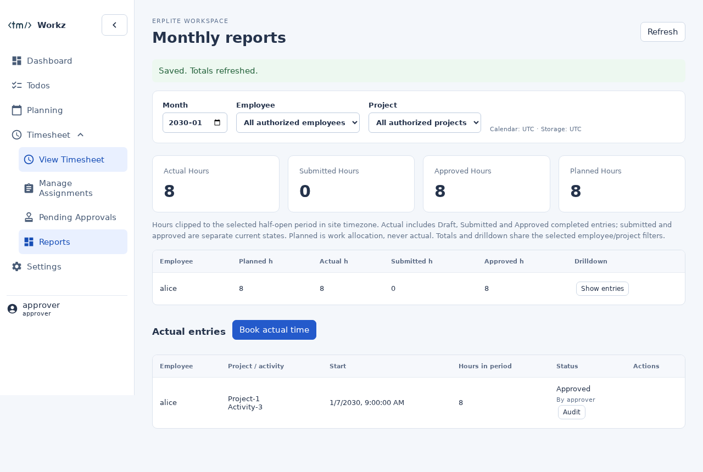
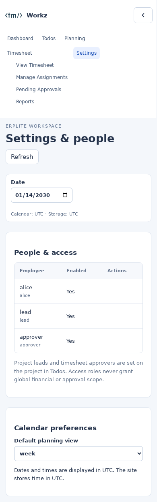

# Validation evidence

All data used here is fabricated. No Crew/virtual-office site, employee history,
permissions, leave or production data was changed.

## Executed checks

- `npm run build`: legacy Vue scheduler and consolidated React/TypeScript Workz
  assets built successfully. Existing Vue large-chunk/Browserslist warnings remain.
- `npm run test:offline`: 697 repository checks pass, including fault injection,
  DocType metadata, API wiring and legacy permission regressions.
- `npm run test:workz`: 31 Python service/domain/import tests and 5 JavaScript
  calendar tests pass. Covers assignments, scopes, self-approval, stale writes,
  private staff availability, immutable decisions/history, overlap rejection,
  effective rates, zero/missing rates, separate currencies and month boundaries.
- Playwright application workflow: 2 tests pass using the production built UI and
  isolated synthetic service adapter. Fresh in-app project/activity/assignment,
  employee/currency/rate setup; plan → ghost → accept → submit → scoped approve →
  reports; role differences; table/week/month, drag move, invalid-drop rollback,
  keyboard resize, persistent Ignore, reload and mobile navigation.
- Real Frappe 15.125.0 / Python 3.11 / MariaDB 10.11.19: clean ERPLite installation,
  schema reload and real transactional workflow pass. Eight acceptance requests
  across independent connections yield one actual entry; 2.5 approved hours
  reconcile to the report. AUD planned cost 100, revenue 250, margin 150 reconcile
  with the effective-rate projection. Unauthorized direct document reads fail.
- Real MariaDB DST regression: New York 01:15 -04:00 → 01:45 -05:00 remains 1.5
  elapsed hours through plan, acceptance and reporting.
- Real authenticated HTTP Playwright: session login, `/workz`, Settings and
  CSRF-protected API pass against the disposable Frappe site.
- Migration: offline validation plus repeated real database import reconcile
  original approved history across January (0.5 hours) and February (1.0 hours).
  Synthetic tests cover missing/changed attachments, conflicting source digests,
  missing identities, illegal metadata, rollback and retained source audit data.
- Whitespace check passes with the repository's existing CRLF convention retained.

The browser used Chromium 141. Native host libraries were supplied through a
local library path; the browser actually executed. MariaDB 10.11 is newer than
Frappe's tested-version advisory, so repeat the suite on the reviewed target's
exact supported stack before cutover. Tests were rerun after the final build;
asset checks must not run concurrently with a build deleting/replacing assets.

## PR #71 DST review regression (2026-10-31)

The reviewer reproduced a failure on `b5e71fe`: submitted/approved November 1,
2026 New York 01:15–01:45 history had authoritative UTC endpoints 05:15–06:45,
but week locking reparsed its ambiguous local start. The new regression failed
before the fix for both workflow statuses. A second regression exposed a Sunday
entry extending into Monday that failed to lock the Monday week.

`check_locked_period` now resolves history through `record_times`, compares UTC
instants against site-local week boundaries, and locks every overlapped week.
Endpoints stay exclusive: history ending at Monday midnight does not lock that
Monday week. No schema/data migration is needed and existing history is untouched.
Unambiguous legacy records without UTC companions continue to resolve in the site
timezone; ambiguous legacy values without companions still require an explicit
reviewed offset rather than guessing a historical instant.

Reproduction and verification commands (from the repository root):

```sh
python3 -m unittest discover -s tests/workz -p test_dst_lock.py
npm run test:workz
npm run build
npm run test:offline
```

Results: 2 new regression tests pass (parameterized over Submitted/Approved),
31 total Python and 5 JavaScript tests pass, both frontends build, and all 697
repository offline checks pass. The 2 application browser tests and real HTTP
browser test were rerun successfully. Existing build warnings are unchanged.
GitHub reports no CI checks/statuses; these are executed local results.

Using the existing disposable Frappe 15.125.0 / MariaDB 10.11.19 bench:

```sh
SITE=workz-synthetic.localhost SITES_PATH=/absolute/bench/sites \
  FRAPPE_BENCH_ROOT=/absolute/bench \
  /absolute/bench/env/bin/python tests/workz/frappe_dst_smoke.py
SITE=workz-synthetic.localhost SITES_PATH=/absolute/bench/sites \
  FRAPPE_BENCH_ROOT=/absolute/bench \
  /absolute/bench/env/bin/python tests/workz/frappe_smoke.py
```

The expanded real DST script reports: `1.5 fold hours preserved; Submitted and
Approved history allow later manual bookings and Accept, while the same week
stays locked.` The full integration rerun again reports 8 concurrent accepts →
1 actual, 2.5 approved hours and unchanged synthetic import reconciliation.
The runtime was reused; clean installation was validated in the original work,
not repeated for this code-only fix. Tests restore the synthetic site timezone.

## Screenshots





## Limits and cutover gates

Crew's actual installed schema, historical export and virtual-office destination
have not been supplied or inspected. The versioned manifest/import/reconciliation
package is ready for a synthetic rehearsal, not a claim that an unknown live
migration has completed. See [the runbook](install-and-cutover.md).

No HRMS app/leave workflow exists in either inspected repository or the disposable
site. The optional request adapter uses installed HRMS permissions and validation;
its target-specific approval workflow remains to be verified. Calendar leave is
explicitly an intention, never automatic approval. SMTP/invitation delivery and
identity-provider integration need the target's infrastructure configuration.
Financial projections exclude overheads, payroll leave, tax and FX conversion.
The legacy Vue compatibility UI remains available during migration; Workz is the
consolidated maintained workflow. No merge, deployment, live import or Crew
shutdown was performed.
